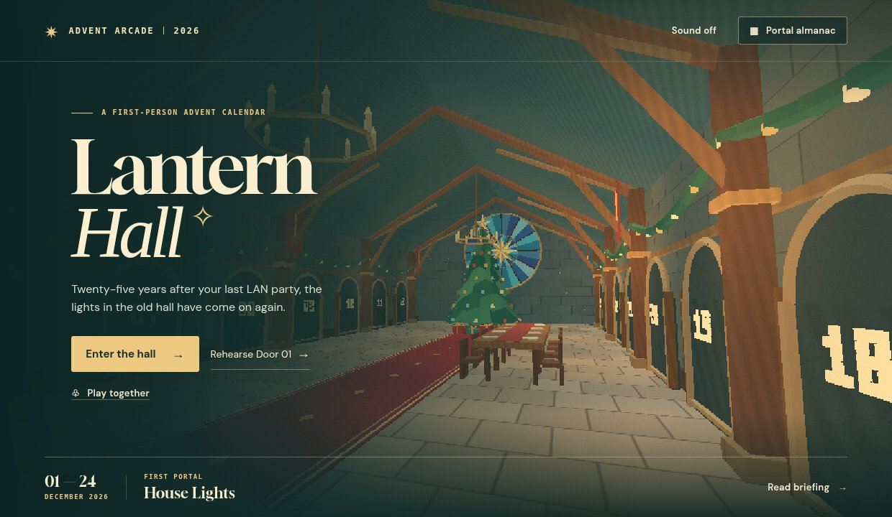

# Lantern Hall

Twenty-five years after a snowbound LAN party, the lights come on in the old municipal hall. A printer in the cloakroom spits out a ticket. On its back someone has written, **please leave one place free**.

**[Play in your browser](https://stbange.github.io/weihnachten2026/)** · **[Read the campaign concept](design/lantern-hall.md)** · **[Explore all 24 missions and their sources](design/portals.md)**



## The calendar

One new arch opens at midnight **Europe/Warsaw**, December 1–24, 2026. Earlier dates stay available, including after Christmas. A new player can join on any evening. The full campaign is designed for about twenty minutes per door, or eight hours across December.

The concept preserves the supplied order, from Duke Nukem 3D to the first Red Alert. Each treatment identifies its reference edition, explains its gameplay and graphics, translates three signature mechanics into first person, and gives the mission a timed route, enemies, a solo/co-op solution and a keepsake for the hall. For the ambiguous titles, day 6 uses the original 1989 PC MechWarrior, day 9 uses Starsiege: Tribes, day 15 uses UFO: Enemy Unknown and day 17 uses Jedi Knight: Dark Forces II.

## What you can play today

The C/SDL3/OpenGL rehearsal includes a walkable hall with all 24 arches and a small cinema. Choose **Rehearse Door 01** at any time. Fold both paper ushers, boost onto the balcony along the left wall, start the projector and punch out at the green entrance door. A rehearsal does not earn a calendar stamp. A live clear saves the ticket on the device. The other 23 doors have complete design treatments and browsable briefings. The 20-minute timings belong to the full campaign.

| Mode | Controls |
| --- | --- |
| Desktop, seat one | WASD moves, mouse or arrows look, F or left click pulses, E uses, Space boosts |
| Second local seat | IJKL moves, U/O turns, Y pulses, H uses, N boosts |
| Mobile browser | Left stick moves, drag on the right to look, tap Pulse or Use, hold Lift |
| WebXR preview | Left stick moves, right stick snap-turns, gaze aims, trigger pulses, grip uses, primary face button lifts |

Choose **Play together** for split screen or a two-browser session. For a direct WebRTC game, the host sends an invitation, the guest sends a reply and the host connects. Both browsers share one authoritative mission. A WebSocket relay option supports networks that block direct connections. Friends can supply their own relay endpoint and use an eight-character room code. The static Pages site serves the game files. [Relay instructions and platform design](design/engineering.md)

## Build and test

Native builds require CMake 3.20+, a C11 compiler, and an installed SDL3 development package. On Windows, make the SDL3 CMake package discoverable through `CMAKE_PREFIX_PATH`. The build copies SDL3.dll beside the executable.

```sh
cmake -S . -B build/native -DCMAKE_BUILD_TYPE=Release
cmake --build build/native --config Release
ctest --test-dir build/native -C Release --output-on-failure
```

Run `lantern-hall` for the calendar, or pass `--rehearsal` and optionally `--split`. Press R to enter rehearsal in a native session. Native co-op in this build is local.

With Emscripten **4.0.20** active, build and serve the web version. It uses the SDK’s SDL3 port.

```sh
bash scripts/build-web.sh
python3 -m http.server 8571 --directory dist
```

Verification uses OpenSpec 2.1.0, GCC/gcov, SDL3, an offscreen Mesa OpenGL driver, Python and Playwright. The coverage gate counts **all four hand-written production C translation units** and fails below 95% executed lines. The separate input replays and browser tests do not inflate this number.

```sh
npx --yes @fission-ai/openspec@2.1.0 validate --all --strict --no-interactive
bash scripts/test-c.sh
python3 -m pip install -r tests/requirements.txt
python3 -m playwright install chromium
python3 tests/web_game.py http://127.0.0.1:8571/
```

Set `CHROMIUM` to use an existing Chromium executable. Add `--direct` to the browser test on a network that permits WebRTC ICE candidates. The ordinary suite starts a loopback WebSocket relay, connects two browser contexts through the visible room UI, folds an usher from the guest and checks the shared result. It also checks all 24 briefings, calendar rollover, split views, mobile controls and a simulated stereo XR session. Two full browser replays drive the normal keyboard controls from entry to extraction and verify that only a live clear earns a stamp.

GCC 14.2 measured **96.73% native C unit line coverage (770/796)**. Both the gameplay rules and scene construction reached 100%. Four separate input replays completed the cinema. The GitHub Actions browser job also passed the direct WebRTC invitation/reply test. The release check built the Windows x86-64 executable, ran the Linux application against real offscreen OpenGL, and compiled and played the Emscripten build in Chromium. The XR device path is experimental. Headset comfort, physical mobile devices and native Windows gameplay still need hands-on playtests. [Continuous verification](https://github.com/stbange/weihnachten2026/actions/workflows/verify.yml) · [OpenSpec capabilities](openspec/specs) · [Remaining campaign work](openspec/changes/complete-campaign/tasks.md)

## Publishing and credits

Develop on `main`. Publish the generated `dist/` tree to `gh-pages`, the repository’s Pages source. From a clean `main` checkout with the tested SDK active, `bash scripts/publish-pages.sh` rebuilds and publishes a fast-forward commit. It requires a GitHub account with push access to this repository.

Code uses the repository’s **MIT License**. Original art and generated sound use **CC BY 4.0**. The classic games are reference works, and the web fonts and runtime dependencies carry their own notices. [Code license](LICENSE) · [Art attribution](ART-CREDITS.md)
